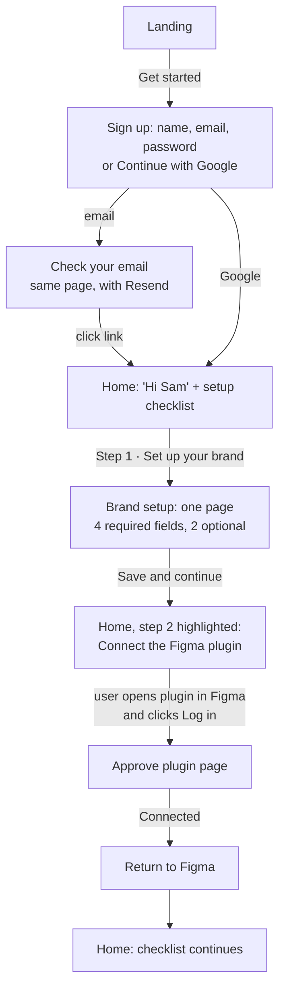
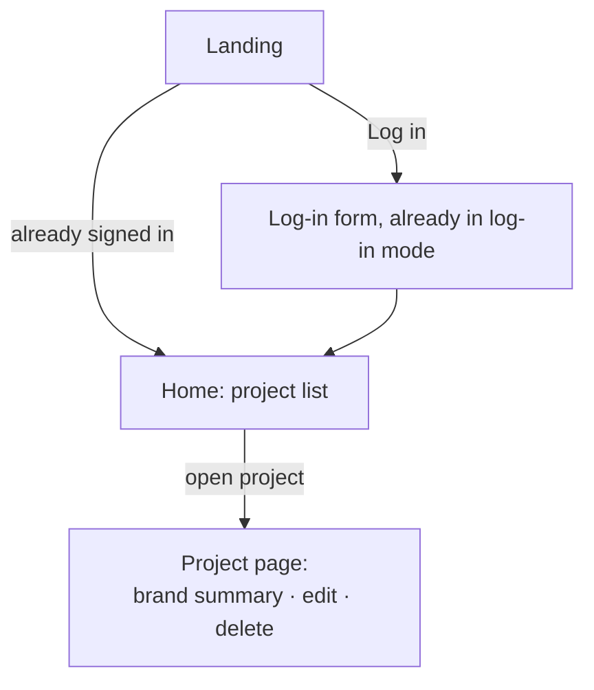
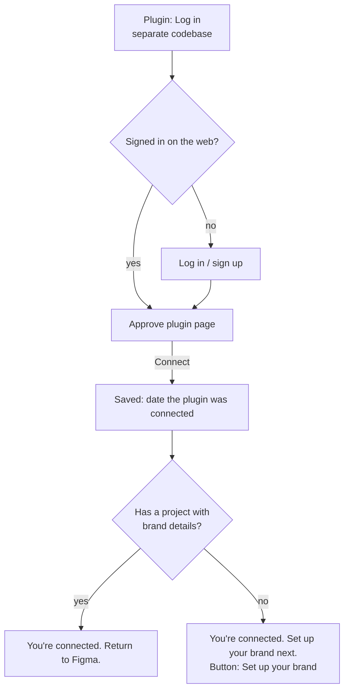

# Web app flow

**Goal:** a new user reaches their first useful audit as fast as possible, in as few steps as possible.
**Status:** design only. Nothing here is built yet.
**Scope:** this web app only. The Figma plugin lives in a separate codebase and isn't covered here.

---

## 1. Decisions

| # | Question | Decision |
| --- | --- | --- |
| 1 | Store audit history? | **On hold.** No audits are saved for now. Revisit after reviewing the UI. |
| 2 | Where are projects created? | **Web only.** |
| 3 | Minimum brand details before the first audit | **Brand name, voice keywords, target audience, narrative stance.** Key terminology and words to avoid stay optional. |
| 4 | Sign-up fields | **One "Name" field** instead of first name + last name. |
| 5 | Email confirmation | **Keep it.** |
| 6 | Where new users start | **Our website.** The web onboarding is the front door. |
| 7 | Per-audit choices (persona, channel, goal, constraints) | **Not part of this web app.** |
| 8 | Plugin published? | **No.** There is no public install link yet (see section 9). |

---

## 2. How it works today

### (a) First-time user
Landing → **Get started** → sign-up form (first name, last name, email, password) → "Check your email" → click the link in the email → empty dashboard → **New project** (name, description) → "Additional details" page (6 brand fields) → **Save** → "Saved." The only next button, **Select Figma Frames**, does nothing. **Dead end.**

### (b) Returning user
Landing → **Get started** → login page opens in *sign-up* mode → **Sign in with password** → log in → dashboard.

### (c) Connecting the plugin
The plugin opens the website → log in or sign up → "Allow the plugin to use your account?" → **Connect Figma** → "You're connected. Close this tab." The website never mentions the plugin anywhere else, and doesn't remember that it was connected.

### (d) Running and reviewing an audit
Everything happens in the plugin. Nothing is saved, so the website can't show past audits.

---

## 3. Friction points

A *dead end* is a screen with no obvious next step.

1. **Dead end after setup.** Saving brand details leads nowhere; "Select Figma Frames" is a button that does nothing.
2. **The plugin is invisible on the web**, even though the product only works through it.
3. **Returning users land on the sign-up form** and must switch to log-in every time.
4. **Creating a project takes two pages**, and a third page edits the same data again.
5. **The project description isn't used by the AI**, so users fill it in for nothing.
6. **The "brand details" check is hollow.** Saving an empty form unlocks audits.
7. **The empty dashboard teaches nothing.** "No projects yet" is plain text; the button sits in the corner.
8. **Project cards show no status**, so you can't tell which projects are ready for audits.
9. **The name is collected but never shown.** The header shows the email instead.
10. **Email confirmation interrupts sign-up** (kept on purpose, see decision 5). Starting on the website (decision 6) means most users are already logged in by the time they connect the plugin, which avoids the slow confirm-email-while-the-plugin-waits case.
11. **Signed-in users still see the landing page** and have to click through to reach their projects.

---

## 4. The optimised flow

The core idea is three steps, each with one obvious action:

> **1. Set up your brand → 2. Connect the Figma plugin → 3. Run your first audit**

A **setup checklist** on the home screen shows these steps. It ticks each one automatically and disappears when all three are done. Every tick can be worked out on the web (see section 7).

### (a) First-time user

### (b) Returning user

### (c) Connecting the plugin

### (d) Running and reviewing an audit

**On hold.** Audits run in the plugin and nothing is saved, so the web shows no audit history for now.

---

## 5. Screens

*Glow* = the single lime hero button allowed per screen.

| Screen | Address | Purpose | Main action | Design-system components |
| --- | --- | --- | --- | --- |
| **Landing** | `/` (signed-in users are sent to Home) | Say what the product does and that it works through a Figma plugin | **Get started** (glow), plus a secondary **Log in** | Card (glass), Button |
| **Sign up / Log in** | `/login` (`?mode=login` opens log-in directly) | Get into an account with as few fields as possible: Name, email, password, or Google | **Create account** / **Log in** | Card, SegmentedControl (Sign up / Log in), Input, Label, Button, InlineMessage |
| **Check your email** | Same page, after sign-up | Turn the email step into a clear wait, not a dead end; shows the address used | **Resend email** | Card, Button, InlineMessage (info) |
| **Home** | `/dashboard` | Greet by name, show the setup checklist until it's done, list projects with status | The current checklist step (glow) | SetupChecklist, EmptyState, AppHeader, Card, Project row pattern, Badge, Button |
| **Brand setup** | `/dashboard/projects/new` | Create the project and its brand details on one page. Project name is prefilled from brand name. Optional fields sit in a closed "More detail (optional)" section | **Save and continue** | Input, Textarea, SegmentedControl (We / I / No person), Label, InlineMessage, Disclosure, Button |
| **Project page** | `/dashboard/projects/[id]` | One home for a project: brand details (view and edit), a "Run an audit in Figma" card, delete | **Edit brand details** | Card, StatRow, Badge, Button |
| **Approve plugin** | `/auth/figma-success` (behaviour unchanged) | Confirm which account the plugin will use; afterwards say what to do next | **Connect** → then **Return to Figma** or **Set up your brand** | Card, Badge (status), Button |

**Removed:** the separate "Additional details" page (`/dashboard/projects/[id]/details`). It's merged into Brand setup, and editing moves to the Project page. The inert "Select Figma Frames" button is replaced by the "Run an audit in Figma" card.

**Not a page:** "Connect the Figma plugin" is a checklist step on Home and a card on the Project page, not its own address. The connection always has to start in the plugin, so these show instructions plus a live "Connected" status.

---

## 6. What lives where

| On the web | In the plugin (separate codebase) |
| --- | --- |
| Account: sign-up, log-in, email confirmation | Logging in (it opens the website) |
| Creating projects and brand details (one-time setup) | Choosing the project for an audit |
| Approving the plugin connection | Per-audit choices: writer persona, channel, goal, constraints, flow description |
| Setup checklist and project status | Selecting text layers and running the audit |
| | Applying or dismissing suggestions on the Figma layers |

**Why:** long-form brand writing is cramped inside a plugin window, so it belongs on the web. Changing text on layers can only happen inside Figma.

---

## 7. Data the web needs

Plain-language list. The exact database design happens at build time.

### 7.1 Audit records

**On hold.** Nothing is saved per audit for now.

### 7.2 Smaller additions
- **Plugin connected date** on the user. Recorded when they press **Connect** on the approval page. Ticks checklist step 2.
- **Name:** one "Name" field at sign-up, saved the same way Google saves a full name, so the greeting works for both. The greeting uses the first word.
- **"Brand details complete"** should mean the 4 required fields are filled in, not just that Save was pressed. This closes the empty-form loophole. The audit check uses the same rule.
- **Project description:** removed from setup (the AI doesn't use it). It can stay as an optional "Notes" field on the Project page.

### 7.3 How the checklist ticks itself
| Step | Done when |
| --- | --- |
| 1. Set up your brand | Any project has its 4 required brand fields |
| 2. Connect the Figma plugin | The user has a plugin-connected date |
| 3. Run your first audit | **To decide.** Needs some saved signal that an audit ran (e.g. a "first audit" date), even without full history |

### 7.4 Project status shown on Home
- **Needs brand details:** required fields missing.
- **Ready:** required fields filled.

---

## 8. Open items

- **Plugin install link (blocker before public launch).** The plugin isn't published, so the "Connect the Figma plugin" step can only say "Open UX Copy Tool in Figma and click Log in". Add the Figma Community link once it's published.
- **Audit history:** on hold until you've reviewed the UI.
- **Checklist step 3** needs a decision on how the web learns that a first audit ran.
- **Email confirmation + plugin:** if someone signs up *from the plugin* and is slow to confirm their email, the plugin may give up waiting. The approval page already handles this with "Start again from Figma". Watch whether it happens in practice.

---

## 9. Design-system pieces for this flow

Built (with docs and `COMPONENT_STATUS.md` rows) unless marked on hold.

| Name | Type | Used on | What it is |
| --- | --- | --- | --- |
| **SetupChecklist** | Component (`ds/`) | Home | 3 steps with done / current / upcoming states; the current step has the one glow button; hides when complete |
| **EmptyState** | Component (`ds/`) | Home, Project page (no audits yet) | Icon, one-line title, one sentence, one action. Teaches the next step |
| **AppHeader** | Component (`ds/`) | All signed-in pages | Logo, user's name with initials, log out |
| **Avatar** | Component (`ui/`) | AppHeader | Circle with the user's initials |
| **Disclosure** | Component (`ui/`, built on base-ui Collapsible) | Brand setup | "More detail (optional)" section that opens and closes |
| **SuggestionDiff** ⏸ on hold | Component (`ds/`) | Audit detail | Original text → suggested text, reason, status badge, copy button |
| **AuditRow** ⏸ on hold | Pattern (ListRow + Badge + StatRow) | Project page | Date, persona, channel, number of suggestions, how many applied |
| **ProjectRow** | Pattern (ListRow + Badge) | Home | Project name, brand name, status badge (section 7.4) |
| **Auth layout** | Pattern | Sign up / Log in, Check your email, Approve plugin | One centred glass card on the gradient background |

Already available and reused: Button, IconButton, Badge, Card, Input, Textarea, Label, SegmentedControl, Select, InlineMessage, ListRow, StatRow, StatusStrip.
Not needed yet: Toast (copy confirmation can be shown inline), Tabs (the Project page is a single scrolling page).
